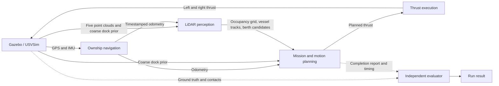

# Autonomous USV Berthing

## Overview

A ROS 2 autonomy stack for a simulated WAM-V. It maps nearby obstacles, tracks moving vessels, selects a berth from dock observations, and controls the boat through approach and final positioning. The stack completed five seeded runs of the competition berthing scenario with zero recorded obstacle collisions.

## Architecture



The perception nodes use the vehicle pose at the sensor measurement time. The controller uses the occupancy grid, moving-object tracks, and observed berth state to plan against the vessel footprint. The evaluator receives Gazebo truth and contact events on a separate path. See [ROS 2 interfaces and frames](docs/architecture.md).

## Components

| Package or entry point | Role |
| --- | --- |
| [`phase16z_s3_runtime`](perception_ws/src/phase16z_s3_runtime) | GPS/IMU navigation, LiDAR candidates, and dynamic vessel tracking with absolute velocity. |
| [`phase17_berthing_perception`](perception_ws/src/phase17_berthing_perception) | Local occupancy grid, LiDAR dock registration, and berth occupancy. |
| [`phase16z_perception_msgs`](perception_ws/src/phase16z_perception_msgs) | Detection and track message definitions. |
| [`full_perception.launch.py`](perception_ws/src/phase17_perception_stack/launch/full_perception.launch.py) | Starts the perception stack. The separate [`phase17_surround_bev`](perception_ws/src/phase17_surround_bev) package provides camera projection and calibration checks. |
| [`competition_user.closed_loop.node`](control_ws/src/competition_user/competition_user/closed_loop/node.py) | Runs mission state, collision-aware planning, terminal approach, and thrust execution. The installed executable is `berthing_node`. |
| [`official_monitor.py`](scripts/official_monitor.py) and [`official_evaluation.py`](scripts/official_evaluation.py) | Capture independent observations and compute run outcomes. |

## Installation & Usage

Use Ubuntu 24.04, ROS 2 Jazzy, and Gazebo Harmonic. Build the [competition USVSim platform](https://gitee.com/little-dolphin-intelligence/2026-challenge-cup/tree/75babf08680736cb932b8e078fdeae1531a10134) at revision `75babf0` (v1.0.5) in a separate workspace. It supplies `vrx_gz`, `wamv_gazebo`, the seeded `berthing_user` world generator, and simulator resources. The evaluation monitor uses `python3-gz-transport13` and `python3-gz-msgs10` from the Gazebo installation.

The run uses [external geometry and model files](THIRD_PARTY_NOTICES.md#external-runtime-assets). Place authorized copies at the listed paths before building. The public checkout includes the source and evaluation records. Reproducing the closed loop requires the external assets as well as USVSim.

From this repository's root in Bash, with `rosdep` initialized and its database up to date:

```bash
sudo apt install python3-colcon-common-extensions python3-rosdep python3-pytest mesa-utils

source /opt/ros/jazzy/setup.bash
export USV_SIM_SETUP="$HOME/USVSim/install/setup.bash"
source "$USV_SIM_SETUP"

rosdep install --from-paths perception_ws/src control_ws/src --ignore-src -r -y
bash scripts/build_all.sh
bash scripts/regressions.sh local
```

Set `USV_SIM_SETUP` to your platform's installed setup file. For a single closed-loop run, start the supervisor with one of the seeds in the table below:

```bash
bash scripts/run_acceptance.sh --mode acceptance --seed 20261004 \
  --max-wall 900 --headless-rendering --sensor-trace
```

The supervisor generates the world, starts the simulator and ROS 2 nodes, and writes `result.json` and `controller/completion.json` under `runtime_output/`. Run one instance at a time. For offline scoring of the included records, see [Results and reproduction](docs/results.md).

## Validation

The frozen autonomy revision `8602b06` completed **5 of 5** runs with the original competition sensor layout and obstacle configuration. The reported cycle is the larger of the peak planning duration and peak full control-cycle duration.

| Seed | Wall time (s) | Sim time (s) | Final error (m) | Speed at completion (m/s) | Peak cycle (ms) | Static / dynamic collisions |
| --- | ---: | ---: | ---: | ---: | ---: | ---: |
| 20261003 | 723.917 | 492.640 | 0.079864 | 0.141333 | 350.848 | 0 / 0 |
| 20261004 | 686.965 | 488.760 | 0.060477 | 0.143430 | 292.337 | 0 / 0 |
| 20261005 | 837.946 | 522.000 | 0.083570 | 0.156406 | 422.911 | 0 / 0 |
| 20261006 | 720.028 | 454.648 | 0.156128 | 0.071757 | 366.793 | 0 / 0 |
| 20261007 | 843.189 | 507.096 | 0.175097 | 0.138779 | 449.626 | 0 / 0 |

The run requirements included 900 s wall time, 0.20 m final position error, 0.20 m/s speed at completion, and a 500 ms planning and control budget. Completion speed was estimated from independent simulated position samples within 40 ms on either side of the completion timestamp. **Berth contact speed was unmeasured** because no berth contact was observed.

The original frozen runtime passed [236 regression tests](evidence/regression_navigation_attitude_projection_01/pytest.log). Its delivery passed [238 tests](evidence/regression_instantaneous_completion_contract_01/pytest.log) after the independent evaluator's completion-speed correction. These are historical counts from the complete delivery. The public suite omits tests tied to the legacy controller and uses the external runtime assets where required.

## Limitations

Validation covers five scenarios from the competition generator. Recorded wall times depend on the host and rendering configuration. The runs used the published coarse dock prior and known sensor mounts. The camera surround-view module was disabled, and the runs did not assess physical berthing, mechanical latching, or real-vessel operation.

## Acknowledgments

This work began as a team competition project. [lry9640971-sudo](https://github.com/lry9640971-sudo) developed the berthing perception and rebuilt the final planning and control stack. The competition simulator builds on [Virtual RobotX (VRX)](https://github.com/osrf/vrx). See [Third-party notices](THIRD_PARTY_NOTICES.md) for credits, applicable licenses, and external assets.
